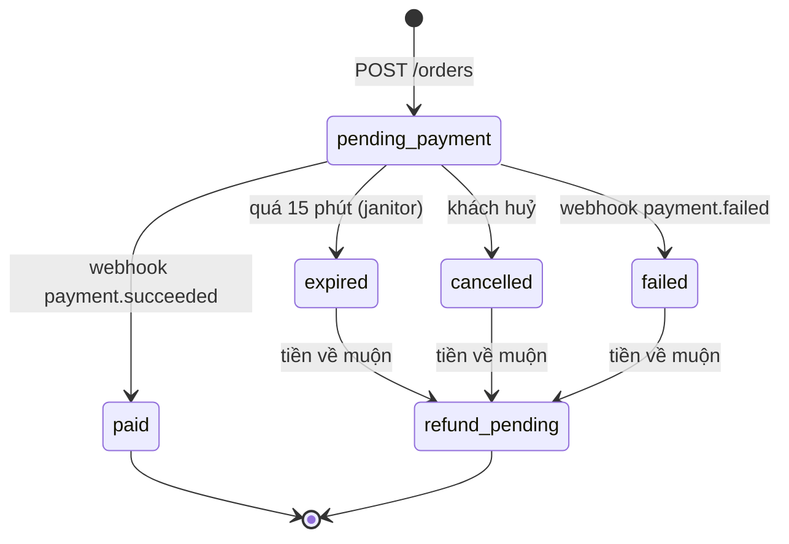
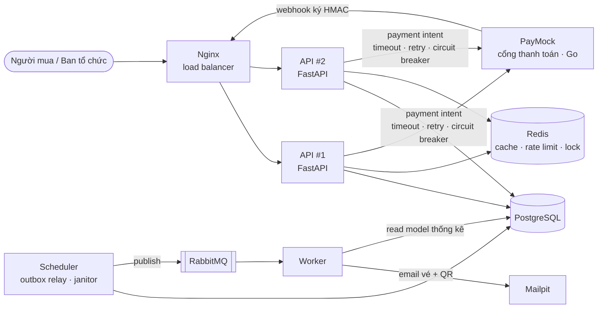

# SănVé — Hệ thống bán vé concert "flash sale"

[](https://github.com/cbien0504/sanve/actions/workflows/ci.yml)

Dự án backend mẫu (portfolio). Nghiệp vụ là hư cấu, nhưng các bài toán kỹ thuật đều là bài toán thật:
nhiều người cùng giành một ghế, khách bấm "thanh toán" hai lần, cổng thanh toán chậm hoặc lỗi,
webhook đến trùng hoặc đến muộn, và phải nhìn được hệ thống đang làm gì khi tải tăng đột biến.

**Stack:** Python 3.14 · FastAPI · SQLAlchemy 2 (async) · PostgreSQL 17 · Redis 7 · RabbitMQ 4 ·
Go 1.25 · Nginx · Docker Compose · Kubernetes (Kustomize) · Prometheus · Grafana · OpenTelemetry/Jaeger ·
GitHub Actions.

---

## Mục lục

- [Bài toán](#bài-toán)
- [Nghiệp vụ](#nghiệp-vụ)
- [Kiến trúc](#kiến-trúc)
- [Kỹ năng thể hiện trong dự án](#kỹ-năng-thể-hiện-trong-dự-án)
- [Chạy thử](#chạy-thử)
- [Kết quả đo được](#kết-quả-đo-được)
- [API](#api)
- [Quyết định thiết kế quan trọng](#quyết-định-thiết-kế-quan-trọng)
- [Kiểm thử](#kiểm-thử)
- [Observability](#observability)
- [Kubernetes](#kubernetes)
- [CI/CD](#cicd)
- [Cấu trúc thư mục](#cấu-trúc-thư-mục)
- [Giới hạn và hướng phát triển](#giới-hạn-và-hướng-phát-triển)

Tài liệu chi tiết: [Kiến trúc & system design](docs/architecture.md) ·
[Cơ sở dữ liệu](docs/database.md) · [Bảo mật](docs/security.md)

---

## Bài toán

SănVé bán vé cho các concert lớn. Khi mở bán, hàng chục nghìn người cùng bấm "mua" trong vài phút đầu
để giành vài nghìn ghế. Hệ thống phải đảm bảo:

1. **Không bao giờ bán một ghế cho hai người**, kể cả khi hàng trăm request đến cùng một mili giây.
2. **Không giữ ghế hay trừ tiền hai lần** khi khách bấm lại, mạng chập chờn, client tự retry.
3. **Không sập theo bên thứ ba**: cổng thanh toán chậm hoặc lỗi thì chỉ luồng thanh toán bị ảnh hưởng.
4. **Ghế không bị "giam"**: ai giữ ghế mà không thanh toán thì ghế tự được mở bán lại.
5. **Quan sát được**: biết request nào chậm, ở đâu, vì sao, và hệ thống có đang bán vượt hay không.

## Nghiệp vụ

| Vai trò | Được làm gì |
|---|---|
| `customer` | Xem sự kiện, giữ ghế, tạo đơn, thanh toán, xem vé của mình |
| `organizer` | Tạo / sửa / mở bán sự kiện của mình, xem thống kê doanh thu |
| `admin` | Mọi thứ, cấp quyền `organizer` cho tài khoản |

**Luồng mua vé**

1. Ban tổ chức tạo sự kiện gồm các hạng vé (VIP, GA...), mỗi hạng là một số hàng ghế. Hệ thống sinh
   sơ đồ ghế (`A-001`, `A-002`...). Sự kiện ở trạng thái `draft` cho tới khi được mở bán (`published`).
2. Khách **giữ ghế** (`POST /holds`): chọn hạng vé và số lượng, hệ thống tự lấy N ghế trống đầu tiên
   và giữ trong 10 phút.
3. Khách **tạo đơn hàng** từ lượt giữ ghế (`POST /orders`), nhận `checkout_url` của cổng thanh toán.
4. Khách thanh toán trên trang của cổng. Cổng gọi **webhook** báo kết quả, đơn chuyển sang `paid`,
   hệ thống phát vé (mỗi ghế một mã) và gửi email kèm mã QR.
5. Các trường hợp bất thường:
   - giữ ghế quá 10 phút mà không tạo đơn → ghế được nhả;
   - đơn không thanh toán sau 15 phút → hết hạn, ghế được nhả;
   - tiền về **sau khi** đơn đã hết hạn (ghế có thể đã bán cho người khác) → đơn sang `refund_pending`
     và khách nhận email hẹn hoàn tiền, không phát vé.

**Quy tắc:** mỗi người mua tối đa 4 vé cho một sự kiện (ban tổ chức chỉnh được, 1–10); chỉ giữ ghế
được khi sự kiện đang mở bán; một lượt giữ ghế chỉ tạo được một đơn hàng.



Mọi chuyển trạng thái đi qua một state machine khai báo tường minh
([`state_machine.py`](services/api/app/domain/state_machine.py)). Chuyển trạng thái không hợp lệ là lỗi
và không bao giờ được ghi xuống database.

## Kiến trúc



| Thành phần | Công nghệ | Vai trò |
|---|---|---|
| `api` (×2) | FastAPI, asyncpg, redis-py, httpx | REST API, stateless, scale ngang |
| `scheduler` | asyncio | Đẩy outbox sang RabbitMQ; dọn ghế/đơn hết hạn |
| `worker` | aio-pika | Gửi email vé (QR), cập nhật read model thống kê |
| `payment-gateway` | **Go** (chỉ dùng thư viện chuẩn) | Cổng thanh toán giả lập: chậm/lỗi ngẫu nhiên, idempotency, webhook ký HMAC có retry |
| `nginx` | Nginx 1.30 | Load balancer, giới hạn request theo IP, request id |
| `postgres` / `redis` / `rabbitmq` | | Dữ liệu, cache + rate limit + lock, message broker |
| `prometheus` / `grafana` / `jaeger` / `mailpit` | | Metrics, dashboard, tracing, hộp thư test |

Chi tiết luồng, cách scale và các tình huống lỗi: [docs/architecture.md](docs/architecture.md).

## Kỹ năng thể hiện trong dự án

| Kỹ năng | Thể hiện thế nào | Xem ở đâu |
|---|---|---|
| **Database chuyên sâu** | `SELECT … FOR UPDATE SKIP LOCKED` để nhiều người mua lấy ghế song song mà không chờ nhau; advisory lock theo (người mua, sự kiện) để giới hạn số vé không bị vượt qua bằng request song song; partial index, GIN trigram index, keyset pagination; optimistic locking bằng cột `version` + ETag; một transaction `REPEATABLE READ` cho báo cáo; `statement_timeout`, `lock_timeout`, connection pool; migration Alembic viết tay (tạo index `CONCURRENTLY`), test cả upgrade lẫn downgrade, CI chạy `alembic check` | [booking.py](services/api/app/domain/booking.py), [models.py](services/api/app/models.py), [migrations](services/api/migrations/versions), [docs/database.md](docs/database.md) |
| **Xác thực & bảo mật** | OAuth2 password flow + JWT (khoá cứng thuật toán, sống 15 phút); refresh token dạng opaque, chỉ lưu hash, xoay vòng và **phát hiện dùng lại** (thu hồi cả "họ" token); logout đưa access token vào denylist; mật khẩu argon2id, đăng nhập không lộ email nào tồn tại qua thời gian phản hồi; RBAC + kiểm tra quyền trên từng đối tượng (trả 404 thay vì 403); webhook xác thực HMAC + chống replay; rate limit; chặn secret yếu khi chạy production; container non-root, Pod Security `restricted` | [security.py](services/api/app/security.py), [domain/auth.py](services/api/app/domain/auth.py), [deps.py](services/api/app/api/deps.py), [signatures.py](services/api/app/core/signatures.py), [docs/security.md](docs/security.md) |
| **Cache & message queue** | Cache-aside có jitter TTL, chống "stampede" (single-flight), vô hiệu hoá cả nhóm key bằng namespace version, micro-cache 2 giây cho số ghế còn lại; distributed lock trên Redis; rate limit token bucket viết bằng Lua (atomic, dùng đồng hồ Redis); RabbitMQ topic exchange, hàng đợi retry có độ trễ (TTL + dead-letter), DLQ, publisher confirms, prefetch; **transactional outbox** + **inbox** chống xử lý trùng | [cache.py](services/api/app/core/cache.py), [rate_limit.py](services/api/app/core/rate_limit.py), [locks.py](services/api/app/core/locks.py), [messaging.py](services/api/app/workers/messaging.py), [relay.py](services/api/app/workers/relay.py), [consumer.py](services/api/app/workers/consumer.py) |
| **Testing** | 68 test Python (unit + integration trên PostgreSQL/Redis thật) và 6 test Go (`-race`). Có test tranh chấp thật: 60 người giành 20 ghế, 1 người bắn 10 request song song để vượt giới hạn, 5 request song song cùng một Idempotency-Key; migration chạy lên–xuống–lên; fake cổng thanh toán bằng `httpx.MockTransport`; **cùng một vector chữ ký HMAC được kiểm ở cả Python và Go**; coverage 93%; script load test | [tests](services/api/tests), [gateway_test.go](services/payment-gateway/gateway_test.go), [scripts/flash_sale.py](scripts/flash_sale.py) |
| **Thiết kế API** | REST theo tài nguyên, version `/api/v1`; lỗi theo RFC 9457 (Problem Details) với `code` ổn định; cursor pagination; `Idempotency-Key`; `ETag`/`If-Match` (412, 428); 429 + `Retry-After`; header `Location`; OpenAPI/Swagger tự sinh | [api/](services/api/app/api), [errors.py](services/api/app/errors.py), [idempotency.py](services/api/app/core/idempotency.py) |
| **System design** | API stateless scale ngang sau load balancer (đo được: 2 → 4 replica, throughput tăng 1,5–1,6 lần); read model cập nhật bất đồng bộ (eventual consistency, đo được độ trễ); timeout, retry có jitter, circuit breaker, bulkhead khi gọi bên thứ ba; tự giảm tính năng khi Redis lỗi thay vì sập; phân tích nút cổ chai và tình huống lỗi | [docs/architecture.md](docs/architecture.md), [payment_gateway.py](services/api/app/integrations/payment_gateway.py), [resilience.py](services/api/app/core/resilience.py) |
| **Observability** | Log JSON có `request_id`, `trace_id`, `user_id`; metrics Prometheus (latency/lỗi theo route template + metrics nghiệp vụ); dashboard Grafana được provision sẵn; **một trace OpenTelemetry đi xuyên HTTP → SQL → outbox → RabbitMQ → worker**; Sentry (tuỳ chọn); `/healthz` khác `/readyz` | [observability/](services/api/app/observability), [middleware.py](services/api/app/api/middleware.py), [deploy/grafana](deploy/grafana) |
| **Async & concurrency** | asyncio từ đầu tới cuối (FastAPI, asyncpg, redis, aio-pika, httpx); argon2 chạy trong thread vì nó nhả GIL; sinh QR (thuần Python, giữ GIL) chạy trong `ProcessPoolExecutor`; giới hạn số việc chạy cùng lúc bằng `Semaphore`; `TaskGroup`; tắt êm (graceful shutdown) khi nhận SIGTERM; timeout ở mọi lời gọi ra ngoài | [mailer.py](services/api/app/integrations/mailer.py), [consumer.py](services/api/app/workers/consumer.py), [scheduler.py](services/api/app/workers/scheduler.py) |
| **Hạ tầng** | Docker multi-stage (uv, user non-root, image Go từ `scratch`); Docker Compose cho toàn bộ stack; Nginx load balancing có resolve DNS động; Kubernetes (Kustomize): probes, HPA, PDB, rolling update, Pod Security `restricted`, root filesystem chỉ đọc, Job chạy migration, đã chạy thử trên kind; CI GitHub Actions: lint, test với service container, `alembic check`, test Go, validate manifest, build image | [docker-compose.yml](docker-compose.yml), [deploy/k8s](deploy/k8s), [.github/workflows/ci.yml](.github/workflows/ci.yml) |
| **Ngôn ngữ backend thứ hai** | Cổng thanh toán viết bằng **Go**: `net/http` routing, `slog`, `context`, goroutine + `sync`, `atomic`, so sánh constant-time, `httptest`, race detector, graceful shutdown, binary tĩnh | [services/payment-gateway](services/payment-gateway) |

## Chạy thử

**Cần có:** Docker (Compose v2), `make`, [`uv`](https://docs.astral.sh/uv/) (để chạy các script demo).

```bash
make up            # build và chạy toàn bộ stack (lần đầu mất vài phút)
make demo          # chạy toàn bộ luồng mua vé, in ra từng bước
make flash-sale    # 500 người mua cùng lúc tranh 100 ghế (BUYERS=..., SEATS=... để đổi)
make test          # test Python (PostgreSQL/Redis thật) + test Go
make lint          # ruff + gofmt + go vet
make down          # dừng (make clean để xoá luôn dữ liệu)
```

`make up` tự tạo file `.env` từ [.env.example](.env.example). Muốn thấy janitor làm việc thì giảm
`HOLD_TTL_SECONDS` / `ORDER_TTL_SECONDS` trong `.env`. Có thể đổi tỉ lệ lỗi giả lập của cổng thanh toán
(`PAYMENT_FAILURE_RATE`) và bật/tắt việc gửi webhook trùng (`PAYMENT_DUPLICATE_WEBHOOKS`).

| Địa chỉ | Là gì |
|---|---|
| http://localhost:8080/docs | Swagger UI (nút **Authorize** dùng OAuth2 password flow) |
| http://localhost:8090 | PayMock: trang thanh toán giả lập (link nằm trong `checkout_url` của đơn hàng) |
| http://localhost:8025 | Mailpit: email vé kèm mã QR |
| http://localhost:3000 | Grafana: dashboard "SanVe overview" (xem ẩn danh, admin: `admin` / `GRAFANA_ADMIN_PASSWORD`) |
| http://localhost:16686 | Jaeger: trace của từng request |
| http://localhost:9090 | Prometheus |
| http://localhost:15672 | RabbitMQ management (`RABBITMQ_USER` / `RABBITMQ_PASSWORD` trong `.env`) |

Tài khoản admin đầu tiên được tạo khi khởi động, lấy từ `BOOTSTRAP_ADMIN_EMAIL` / `BOOTSTRAP_ADMIN_PASSWORD`.

## Kết quả đo được

Đo trên một laptop (12 nhân), mọi thành phần chạy chung máy, nên đây là số tham khảo, không phải benchmark.

**`make demo`** (rút gọn):

```
▶ Khách giữ 2 ghế VIP (gửi kèm Idempotency-Key)
  seats: ["A-001", "A-002"]
  Gửi lại cùng key → 201, Idempotent-Replayed: true
▶ Tạo đơn hàng → nhận checkout_url từ cổng thanh toán (Go)
▶ Webhook (đã ký HMAC) chuyển đơn hàng sang 'paid'
  Đơn hàng paid sau 0.2s
▶ Read model thống kê cập nhật bất đồng bộ (outbox → RabbitMQ → worker)
  Projection bắt kịp sau 421 ms (eventual consistency)
```

**`make flash-sale`**: 1.000 người mua cùng lúc (tối đa 200 kết nối đồng thời) tranh 200 ghế:

| Số replica API | Kết quả | Throughput | p50 | p95 |
|---|---|---|---|---|
| 2 | 200 giữ ghế thành công, 800 `sold_out`, **0 ghế trùng** | 314–331 req/s | ~550 ms | ~1,15 s |
| 4 | 200 giữ ghế thành công, 800 `sold_out`, **0 ghế trùng** | 485–524 req/s | ~350 ms | ~0,7 s |

Throughput tăng khi thêm replica vì API không giữ trạng thái. Mức tăng không tuyến tính vì PostgreSQL,
Redis và chính chương trình tạo tải chạy chung máy. Lần đo đầu tiên dùng `httpx` làm client tạo tải và
cho kết quả thấp, không ổn định: client tốn ~6,5 ms CPU mỗi request nên chính nó là nút cổ chai.
Chuyển sang `aiohttp` (~0,6 ms/request) mới đo đúng được server.

**Query plan** (dữ liệu thật trong [docs/database.md](docs/database.md)):

| Truy vấn | Cách đang dùng | Cách thông thường |
|---|---|---|
| Tìm sự kiện theo từ khoá hiếm (305k sự kiện) | 0,05 ms (GIN trigram) | 47 ms (seq scan song song) |
| Trang danh sách ở vị trí thứ 200.000 | 0,05 ms, 4 buffer (cursor) | 16 ms, 1.902 buffer (`OFFSET`) |
| Lấy 2 ghế trống ngay sau khi 6.000 ghế vừa bán | 8 buffer (sau VACUUM) | 129 buffer (partial index còn entry chết, xem phần autovacuum) |

## API

| Method | Đường dẫn | Ai được gọi | Mô tả |
|---|---|---|---|
| POST | `/api/v1/auth/register` | ai cũng được | Đăng ký (role `customer`) |
| POST | `/api/v1/auth/token` | ai cũng được | Đăng nhập (OAuth2 form), trả access + refresh token |
| POST | `/api/v1/auth/refresh` | có refresh token | Đổi token (xoay vòng, phát hiện dùng lại) |
| POST | `/api/v1/auth/logout` | đã đăng nhập | Thu hồi refresh token + access token hiện tại |
| GET | `/api/v1/users/me` | đã đăng nhập | Thông tin tài khoản |
| PATCH | `/api/v1/admin/users/{id}/role` | admin | Đổi role |
| GET | `/api/v1/events` | ai cũng được | Sự kiện sắp diễn ra (lọc `city`, tìm `q`, cursor pagination, cache 30 s) |
| GET | `/api/v1/events/{id}` | ai cũng được* | Chi tiết + số ghế còn trống theo hạng (*bản nháp: chỉ chủ sự kiện) |
| POST | `/api/v1/events` | organizer, admin | Tạo sự kiện + sơ đồ ghế |
| PATCH | `/api/v1/events/{id}` | chủ sự kiện, admin | Sửa, **bắt buộc `If-Match`** |
| POST | `/api/v1/events/{id}/publish` | chủ sự kiện, admin | Mở bán |
| GET | `/api/v1/events/{id}/stats` | chủ sự kiện, admin | Số ghế thực tế + read model doanh thu |
| POST | `/api/v1/holds` | đã đăng nhập | Giữ ghế, **bắt buộc `Idempotency-Key`**, rate limit 10/phút/người |
| GET / DELETE | `/api/v1/holds/{id}` | chủ lượt giữ | Xem / nhả ghế |
| POST | `/api/v1/orders` | chủ lượt giữ | Tạo đơn (gọi lại an toàn: một lượt giữ chỉ có một đơn) |
| GET | `/api/v1/orders`, `/api/v1/orders/{id}` | chủ đơn, admin | Danh sách (mới nhất trước) / chi tiết |
| POST | `/api/v1/orders/{id}/cancel` | chủ đơn | Huỷ đơn đang chờ thanh toán |
| GET | `/api/v1/orders/{id}/tickets` | chủ đơn, admin | Vé và mã vé |
| POST | `/api/v1/webhooks/payments` | cổng thanh toán | Xác thực bằng chữ ký HMAC, không dùng JWT |
| GET | `/healthz`, `/readyz` | hạ tầng | Liveness / readiness |

**Quy ước chung**

- Lỗi luôn có dạng Problem Details, `code` dùng để xử lý trong code, `request_id` dùng để tra log:

  ```json
  {
    "type": "urn:sanve:problem:sold_out",
    "title": "Conflict",
    "status": 409,
    "detail": "Not enough seats left in this tier",
    "instance": "/api/v1/holds",
    "code": "sold_out",
    "request_id": "6f1c0e2b9d6a4c3e8f..."
  }
  ```

- Danh sách trả `{"items": [...], "next_cursor": "..."}`; truyền `next_cursor` vào `cursor` để lấy trang sau.
- Gửi lại `POST /holds` với cùng `Idempotency-Key` sẽ nhận lại đúng response cũ (header
  `Idempotent-Replayed: true`); dùng lại key đó cho nội dung khác thì nhận 422.
- `PATCH /events/{id}` cần header `If-Match` lấy từ `ETag`: thiếu thì 428, dữ liệu đã bị người khác
  sửa thì 412.
- Bị giới hạn tốc độ thì nhận 429 kèm `Retry-After`.

## Quyết định thiết kế quan trọng

Mỗi lựa chọn đều có đánh đổi; phân tích đầy đủ ở [docs/architecture.md](docs/architecture.md) và
[docs/database.md](docs/database.md).

- **Chọn ghế bằng `FOR UPDATE SKIP LOCKED`** thay vì khoá bảng hay dùng `SERIALIZABLE`: các giao dịch
  song song tự lấy những ghế *khác nhau* thay vì xếp hàng chờ cùng một dòng. Unique constraint
  `tickets.seat_id` là lớp chặn cuối cùng ngay trong database.
- **Giới hạn vé mỗi người bằng advisory lock** trên (người mua, sự kiện): đếm rồi ghi trong cùng
  transaction mà không có khoá thì 10 request song song đều thấy "mới có 0 vé".
- **Idempotency key ghi chung transaction với nghiệp vụ**: request trùng sẽ chờ trên unique index rồi
  nhận lại response cũ. Không thể có trạng thái "key đã lưu nhưng việc chưa làm" hoặc ngược lại.
- **Gọi cổng thanh toán ngoài transaction**: tạo đơn (commit) → gọi cổng → lưu payment intent. Không giữ
  khoá dòng trong lúc chờ mạng. Gọi lại an toàn nhờ unique `orders.hold_id` và Idempotency-Key gửi sang cổng.
- **Transactional outbox** thay vì publish thẳng lên RabbitMQ: không mất message khi process chết sau
  commit, không publish message của transaction đã rollback. Phía nhận chống trùng bằng bảng inbox.
- **JWT stateless 15 phút + refresh token có trạng thái**: luồng giữ ghế không phải đọc user từ DB;
  đổi role có hiệu lực ở lần refresh sau; logout dùng denylist trên Redis.
- **Metrics ở cổng nội bộ 9100**, không đi qua load balancer công khai.
- **Khi Redis lỗi**: cache và rate limit cho request đi tiếp (fail-open) để Redis không trở thành điểm
  chết; tính đúng đắn của việc bán vé chỉ dựa vào PostgreSQL.

## Kiểm thử

```bash
make test                      # trong Docker, như CI
# hoặc chạy trực tiếp (cần PostgreSQL/Redis của docker compose đang chạy):
cd services/api && uv sync && uv run pytest -q
```

- **Unit** ([tests/unit](services/api/tests/unit)): state machine, chữ ký webhook (kèm vector dùng chung
  với Go), JWT (sai secret, hết hạn, `alg: none`), argon2, retry/circuit breaker của payment client,
  cursor, validation đầu vào.
- **Integration** ([tests/integration](services/api/tests/integration)): gọi API qua ASGI với PostgreSQL và
  Redis thật. Có các test tranh chấp, idempotency song song, optimistic locking, xoay vòng refresh token,
  rate limit, webhook trùng/giả mạo/replay, janitor và thanh toán muộn, outbox relay, read model, email
  có QR (escape HTML).
- **Migration**: mỗi lần chạy test đều `upgrade head → downgrade base → upgrade head`; CI chạy thêm
  `alembic check` để bắt model và migration lệch nhau.
- **Go**: `go test -race`, gồm cả test webhook bị lỗi lần đầu rồi được retry.
- **Tải**: [scripts/flash_sale.py](scripts/flash_sale.py) tự kiểm tra không có ghế trùng sau khi chạy.

## Observability

- **Log**: JSON mỗi dòng, có `request_id` (nhận từ nginx hoặc tự sinh), `trace_id`, `user_id`.
  Mỗi request có một dòng access log ghi route template, status và thời gian xử lý.
- **Metrics**: `http_requests_total` và `http_request_duration_seconds` gắn nhãn theo *route template*
  (`/api/v1/events/{event_id}`) để số lượng series không phình theo id; metrics nghiệp vụ
  `sanve_holds_total{outcome}`, `sanve_order_transitions_total`, `sanve_payment_gateway_calls_total`,
  `sanve_outbox_lag_seconds`, `sanve_messages_processed_total{queue,outcome}`, `sanve_cache_requests_total`...
- **Dashboard**: Grafana mở sẵn "SanVe overview" (request/s, p95, tỉ lệ 5xx, outbox lag, kết quả giữ ghế,
  cổng thanh toán, hàng đợi, rate limit, cache hit ratio).
- **Tracing**: trace context được lưu vào dòng outbox và truyền qua header RabbitMQ. Trong Jaeger, một
  webhook thanh toán là **một trace** gồm span HTTP, các câu SQL, và span `process notifications` /
  `process sales-stats` của worker.
- **Sentry**: đặt `SENTRY_DSN` để gửi lỗi.

## Kubernetes

[deploy/k8s/base](deploy/k8s/base) mô tả cấu hình cho production: Deployment cho api/worker/scheduler,
Service, Ingress, HPA (3–20 pod, scale lên nhanh, scale xuống chậm), PodDisruptionBudget, Job chạy
migration, namespace bật Pod Security `restricted` (non-root, bỏ hết capability, root filesystem chỉ đọc).
Probe tách rõ: liveness chỉ kiểm tra process, readiness kiểm tra DB và Redis. PostgreSQL, Redis và
RabbitMQ được coi là dịch vụ managed; secret tạo ngoài Git.

[deploy/k8s/overlays/local](deploy/k8s/overlays/local) thêm PostgreSQL/Redis/RabbitMQ/Mailpit/PayMock
tạm thời để chạy trên máy. Đã chạy thử trên kind (migration, readiness và toàn bộ `make demo` qua
port-forward):

```bash
docker compose build
kind create cluster --name sanve
kind load docker-image sanve-api:local sanve-payment-gateway:local --name sanve
kubectl apply -k deploy/k8s/overlays/local
kubectl -n sanve wait --for=condition=complete job/sanve-migrate --timeout=300s
kubectl -n sanve port-forward svc/sanve-api 8080:80     # API
kubectl -n sanve-infra port-forward svc/payment-gateway 8090:8090   # trang thanh toán (terminal khác)
make k8s-validate                                        # kiểm manifest với schema Kubernetes
```

## CI/CD

[.github/workflows/ci.yml](.github/workflows/ci.yml) chạy với mọi pull request và mỗi lần push lên `main`:

1. **API**: `ruff check` và `ruff format --check`; pytest trên PostgreSQL + Redis (service container),
   kèm coverage; `alembic check`.
2. **Payment gateway**: `gofmt`, `go vet`, `go test -race`.
3. **Manifests**: render Kustomize, validate bằng kubeconform.
4. **Images**: build cả hai image khi các job trên đều qua; trên `main` thì push lên GHCR, tag theo commit SHA.

## Cấu trúc thư mục

```
sanve/
├── services/
│   ├── api/                      # Python: API, scheduler, worker dùng chung một image
│   │   ├── app/
│   │   │   ├── api/              # router HTTP, dependency (auth, RBAC, rate limit), middleware
│   │   │   ├── core/             # cache, lock, rate limit, idempotency, resilience, chữ ký, cursor
│   │   │   ├── domain/           # nghiệp vụ: auth, events, booking, state machine, outbox
│   │   │   ├── integrations/     # client cổng thanh toán, gửi email
│   │   │   ├── observability/    # log, metrics, tracing
│   │   │   ├── workers/          # outbox relay, consumer, scheduler, handler
│   │   │   ├── models.py         # SQLAlchemy models
│   │   │   └── schemas.py        # Pydantic schemas
│   │   ├── migrations/           # Alembic (viết tay)
│   │   ├── tests/                # unit + integration
│   │   └── Dockerfile
│   └── payment-gateway/          # Go: cổng thanh toán giả lập
├── deploy/
│   ├── k8s/                      # Kustomize base + overlay local
│   ├── nginx/  prometheus/  grafana/  postgres/
├── scripts/                      # demo.py, flash_sale.py (chạy bằng uv)
├── docs/                         # architecture.md, database.md, security.md
├── .github/workflows/ci.yml
├── docker-compose.yml
└── Makefile
```

## Giới hạn và hướng phát triển

Những điểm dự án **chưa** làm, nêu ra để rõ phạm vi:

- **Hoàn tiền** mới dừng ở trạng thái `refund_pending` + email; chưa gọi API hoàn tiền của cổng.
- **Chọn ghế cụ thể** trên sơ đồ (hiện hệ thống tự chọn N ghế trống đầu tiên trong hạng vé).
- **Phòng chờ ảo** (virtual waiting room) cho các đợt mở bán cực lớn: xếp hàng người mua trước khi
  vào API, thay vì để mọi request đập vào database rồi nhận `sold_out`.
- **PgBouncer** khi số pod tăng (xem tính toán số kết nối trong [configmap](deploy/k8s/base/configmap.yaml)),
  read replica cho các truy vấn đọc, partition bảng `seats` theo sự kiện.
- Redis lock hiện chạy trên một instance; cần fencing token nếu lock bảo vệ dữ liệu quan trọng (ở đây
  tính đúng đắn đã dựa vào PostgreSQL).
- Quét lỗ hổng image (Trivy) và load test bằng k6 trong CI; frontend.
