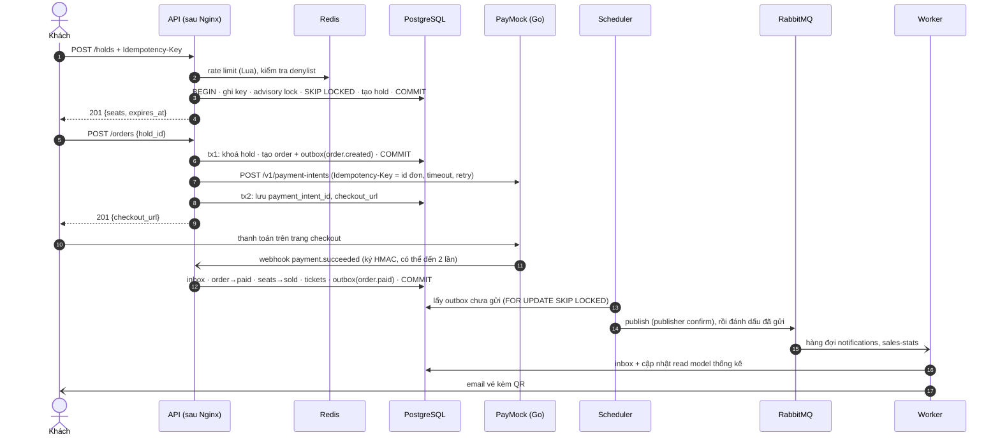

# Kiến trúc và system design

## Luồng mua vé đầy đủ

Ba điểm quan trọng của luồng này:

1. **Giữ ghế là một transaction ngắn duy nhất**, không gọi ra ngoài. Đây là đoạn bị tranh chấp nhiều
   nhất nên phải ngắn nhất.
2. **Gọi cổng thanh toán nằm giữa hai transaction**: không giữ khoá dòng trong lúc chờ mạng. Nếu cổng
   lỗi sau bước 1, đơn hàng vẫn còn; client gọi lại `POST /orders` với cùng `hold_id`, hệ thống tìm thấy
   đơn cũ và chỉ thử lại bước gọi cổng.
3. **Mọi việc phụ (email, thống kê) chạy sau khi commit**, qua outbox. Webhook trả lời ngay sau khi ghi
   xong trạng thái thanh toán.

## Mô hình nhất quán

| Dữ liệu | Nhất quán | Cơ chế |
|---|---|---|
| Ghế, lượt giữ, đơn hàng, vé | Mạnh | Một PostgreSQL, transaction, khoá dòng, unique constraint |
| Số ghế còn lại hiển thị trên trang sự kiện | Trễ tối đa ~2 s | Micro-cache trên Redis |
| Danh sách sự kiện | Trễ tối đa 30 s; sự kiện mới hiện ngay | Cache + tăng namespace version khi mở bán/sửa |
| Thống kê doanh thu (`projection`) | Cuối cùng (eventual) | Outbox → RabbitMQ → worker; đo được ~0,2–0,4 s |
| Email | Ít nhất một lần | Có thể gửi trùng nếu worker chết giữa "gửi" và "đánh dấu" |

`GET /events/{id}/stats` trả cả số đếm trực tiếp từ bảng `seats` lẫn read model, để thấy rõ khoảng
trễ của eventual consistency.

Message được giao **ít nhất một lần** và có thể **không theo thứ tự** (nhiều relay, retry), nên mọi
consumer phải idempotent (bảng `processed_messages`) và mọi cập nhật read model là phép cộng, kết quả
không phụ thuộc thứ tự.

## Scale ngang

- **API không giữ trạng thái**: mọi trạng thái nằm trong PostgreSQL/Redis, JWT tự kiểm tra được. Chạy
  một process mỗi container và scale bằng số replica (không dùng `uvicorn --workers`). Nginx resolve lại
  DNS mỗi 10 giây nên replica mới nhận traffic trong vòng 10 giây; Prometheus phát hiện replica qua DNS.
- **Rate limit dùng chung** qua Redis (Lua, dùng đồng hồ của Redis), nên giới hạn đúng dù request của
  một người rơi vào replica nào.
- **Circuit breaker là của từng process**: mỗi replica tự bảo vệ mình, không cần phối hợp.
- **Worker** là competing consumers trên RabbitMQ; thêm replica khi hàng đợi dài ra.
- **Scheduler** chạy nhiều replica an toàn: relay chia việc bằng `SKIP LOCKED`, job dọn dẹp lấy thêm
  Redis lock để không làm trùng việc.
- Trên Kubernetes: HPA theo CPU, 3–20 pod, scale lên không chờ (flash sale tăng tải trong vài giây),
  scale xuống sau 5 phút ổn định.

**Số đo** (laptop 12 nhân, mọi thứ chung máy, 1.000 người mua cùng lúc):

| Replica API | Throughput | p95 |
|---|---|---|
| 2 | 314–331 req/s | ~1,15 s |
| 4 | 485–524 req/s | ~0,7 s |

### Ước lượng cho một đợt mở bán thật

Giả định một show 20.000 ghế, 200.000 người vào trong 5 phút đầu, mỗi người thử giữ ghế khoảng 3 lần:

- Trung bình: 600.000 request / 300 s = **2.000 req/s**; 30 giây đầu có thể gấp 5 lần, **~10.000 req/s**.
- Số đo cho thấy mỗi process API xử lý ~120–160 req/s trên laptop. Giả sử máy chủ thật nhanh gấp đôi,
  đỉnh 10.000 req/s cần **~30–40 pod**. Phần này scale được.
- **Nút cổ chai thật sự là PostgreSQL**: mỗi lượt giữ ghế khoảng 10 câu lệnh trong một transaction, kể
  cả khi kết quả là `sold_out`. Hàng chục nghìn transaction/giây trên một primary là quá sức.

Hướng xử lý theo thứ tự đáng làm:

1. **Phòng chờ ảo** trước API: chỉ cho vào một lượng người mỗi giây mà database chịu được. Trải nghiệm
   tốt hơn (biết mình đang xếp thứ mấy) và bảo vệ toàn hệ thống.
2. **Đường tắt `sold_out`**: một bộ đếm số ghế còn lại trên Redis (giảm khi giữ, tăng khi nhả); hết ghế
   thì trả 409 ngay, không chạm vào PostgreSQL. Database vẫn là nơi quyết định cuối cùng.
3. **PgBouncer** để số kết nối không tăng theo số pod; partition `seats` theo sự kiện, hoặc tách database
   riêng cho các sự kiện nóng.

## Ngân sách timeout và retry

Mọi lời gọi ra ngoài đều có timeout. Retry chỉ dùng khi thao tác idempotent, và có backoff + jitter để
các client không retry cùng một nhịp.

| Đoạn | Timeout | Retry |
|---|---|---|
| Nginx → API | connect 2 s, read 30 s | Chỉ sang replica khác khi lỗi kết nối; không retry POST |
| API → PostgreSQL | statement 5 s, lock 3 s | Không (trả 503/409 kèm `Retry-After` để client quyết định) |
| API → Redis | 1 s | Không (fail-open) |
| API → PayMock | connect 1 s, read 2 s | 3 lần, backoff 0,2 s × 2ⁿ có jitter, cùng Idempotency-Key; circuit breaker 5 lỗi / 30 s; tối đa 50 lời gọi đồng thời mỗi process |
| PayMock → webhook | 5 s | 6 lần, backoff 0,5 s × 2ⁿ có jitter |
| Worker → SMTP | 10 s | Hàng đợi retry 1 s → 5 s → 30 s, sau đó vào DLQ |

## Khi một thành phần gặp sự cố

| Sự cố | Hệ thống phản ứng |
|---|---|
| Cổng thanh toán chậm hoặc lỗi | Retry rồi trả 503 `payment_unavailable` + `Retry-After`; lỗi liên tiếp thì circuit breaker trả 503 ngay, không chờ. Đơn hàng đã tạo vẫn giữ nguyên. Xem sự kiện và giữ ghế không bị ảnh hưởng. |
| Cổng đã tạo intent nhưng mình timeout | Retry với cùng Idempotency-Key, cổng trả lại intent cũ, không tạo thêm. |
| Webhook đến hai lần | Bảng inbox: lần thứ hai trả `duplicate`, không xử lý lại. |
| Webhook giả mạo hoặc bị phát lại | Sai HMAC hoặc timestamp quá 5 phút → 401. |
| Số tiền / intent trong webhook không khớp | Ghi log lỗi, không đổi trạng thái đơn, vẫn trả 2xx để cổng không gửi lại mãi. |
| Tiền về sau khi đơn hết hạn | `refund_pending`, không phát vé, gửi email hẹn hoàn tiền. |
| Pod API chết giữa request | Transaction chưa commit tự rollback. Client gửi lại `POST /holds` cùng key, hoặc `POST /orders` cùng hold, đều an toàn. |
| Scheduler chết sau khi publish, trước khi commit | Message được publish lại (at-least-once); consumer bỏ qua bản trùng. |
| RabbitMQ ngừng | Mua vé vẫn chạy (chỉ ghi outbox). `sanve_outbox_lag_seconds` tăng, nên đặt cảnh báo trên chỉ số này. Broker quay lại thì relay đẩy hết phần tồn; worker/scheduler tự kết nối lại và chờ broker khi khởi động. |
| Consumer lỗi liên tục (SMTP sập, bug) | Retry qua các hàng đợi trễ, sau đó vào `*.dlq` để người xử lý; không chặn các message khác. |
| Redis ngừng | Cache và rate limit cho request đi qua; denylist tạm mất tác dụng (access token chỉ sống 15 phút); `/readyz` báo lỗi. Tính đúng đắn của việc bán vé không phụ thuộc Redis. |
| PostgreSQL chậm hoặc ngừng | Câu lệnh quá 5 s bị huỷ (503); chờ khoá quá 3 s trả 409 `resource_busy`; `/readyz` lỗi nên pod rời khỏi load balancer. Không mất dữ liệu đã commit. |
| Deploy phiên bản mới | Rolling update `maxUnavailable: 0`; `preStop` chờ 5 s để endpoint được gỡ; uvicorn xử lý nốt request (graceful shutdown 20 s); worker xử lý nốt message trong 25 s; migration chạy trong Job riêng trước khi rollout. |

## Async và concurrency

- **asyncio từ đầu đến cuối**: FastAPI, asyncpg, `redis.asyncio`, aio-pika, httpx. Một process phục vụ
  hàng trăm request đang chờ I/O.
- **Việc tốn CPU không được chạy trên event loop**:
  - argon2 (~50 ms) chạy bằng `asyncio.to_thread`. Thread là đủ vì argon2 là mã C và **nhả GIL** trong
    lúc băm.
  - Sinh mã QR là Python thuần, **giữ GIL**, nên thread không giúp gì. Việc này chạy trong
    `ProcessPoolExecutor` của worker.
- **Giới hạn số việc chạy cùng lúc** bằng `asyncio.Semaphore`: số lời gọi tới cổng thanh toán (bulkhead),
  số message mỗi hàng đợi được xử lý song song (kết hợp `prefetch_count` của RabbitMQ).
- **`asyncio.TaskGroup`** chạy các vòng lặp định kỳ của scheduler; lỗi trong một job được log và không
  làm chết các job khác.
- **Graceful shutdown**: SIGTERM đặt một `asyncio.Event`, các vòng lặp dừng nhận việc mới, hoàn tất việc
  đang làm rồi mới đóng kết nối.

## Bài học khi đo tải

Lần đo đầu tiên cho kết quả kỳ lạ: thêm replica API mà throughput không tăng, p95 nhảy từ 1 s lên 5 s
giữa các lần chạy. Log của API cho thấy phía server chỉ mất 250–480 ms mỗi request, trong khi client
phải chờ tới 5 s. Đo CPU của chương trình tạo tải thì thấy nó dùng 84% một nhân, ~6,5 ms CPU cho mỗi
request `httpx`: **chính client là nút cổ chai**. Chuyển sang `aiohttp` (~0,6 ms/request) thì số đo
ổn định và thấy rõ hiệu quả khi scale ngang. Muốn đo server thì trước hết phải chắc client không phải
là thứ chậm nhất.
