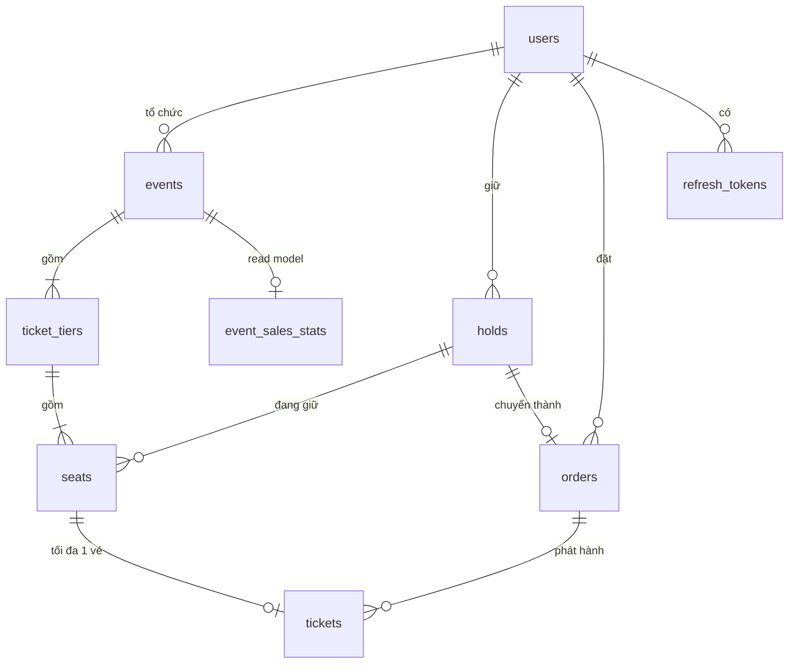

# Cơ sở dữ liệu

PostgreSQL là nguồn sự thật duy nhất cho ghế, đơn hàng và vé. Mọi bảo đảm "không bán trùng" đều nằm ở
đây; Redis và RabbitMQ chỉ giúp nhanh hơn và tách việc phụ ra khỏi request.

Tất cả số liệu trong tài liệu này đo trên PostgreSQL 17 của `docker compose`, bằng
`EXPLAIN (ANALYZE, BUFFERS)`.

## Mô hình dữ liệu



Bảng phụ trợ: `idempotency_keys`, `outbox`, `processed_messages` (inbox).

**Trạng thái là `VARCHAR` + `CHECK`, không dùng `ENUM`**: thêm giá trị vào một ENUM của PostgreSQL
không chạy được trong transaction ở các bản cũ, còn bỏ giá trị thì gần như phải tạo lại type. Thay một
CHECK constraint chỉ là một migration ngắn.

## Bất biến do database đảm bảo

Code có thể có bug, nên các bất biến quan trọng nhất được khoá bằng constraint:

| Bất biến | Constraint |
|---|---|
| Một ghế chỉ có một vé | `UNIQUE (tickets.seat_id)` |
| Một lượt giữ ghế chỉ tạo một đơn | `UNIQUE (orders.hold_id)` (đây cũng là thứ làm `POST /orders` gọi lại an toàn) |
| Một Idempotency-Key của một người chỉ dùng một lần | `PRIMARY KEY (user_id, key)` |
| Một message chỉ được một consumer xử lý một lần | `PRIMARY KEY (consumer, message_id)` |
| Nhãn ghế không trùng trong một sự kiện | `UNIQUE (event_id, label)` |
| Mở bán trước khi diễn | `CHECK (sale_starts_at < starts_at)` |
| Trạng thái hợp lệ | `CHECK (status IN (...))` trên mọi bảng có trạng thái |

## Index và truy vấn mà mỗi index phục vụ

| Index | Loại | Phục vụ |
|---|---|---|
| `ix_seats_tier_available (tier_id, id) WHERE status = 'available'` | B-tree, **partial** | Lấy ghế trống; đếm ghế còn lại |
| `ix_seats_hold_id (hold_id) WHERE hold_id IS NOT NULL` | B-tree, partial | Nhả ghế / bán ghế của một lượt giữ |
| `ix_holds_active_expires_at (expires_at) WHERE status = 'active'` | B-tree, partial | Janitor tìm lượt giữ hết hạn |
| `ix_orders_pending_expires_at (expires_at) WHERE status = 'pending_payment'` | B-tree, partial | Janitor tìm đơn hết hạn |
| `ix_orders_user_created (user_id, created_at, id)` | B-tree | "Đơn của tôi", mới nhất trước, cursor |
| `ix_holds_user_event`, `ix_orders_user_event` | B-tree | Đếm số vé một người đã giữ/mua cho một sự kiện |
| `ix_events_published_starts_at (starts_at, id) WHERE status = 'published'` | B-tree, partial | Danh sách sự kiện công khai, cursor |
| `ix_events_published_city (city, starts_at, id) WHERE …` | B-tree, partial | Lọc theo thành phố |
| `ix_events_title_trgm` | **GIN `pg_trgm`** | `title ILIKE '%từ khoá%'` |
| `ix_outbox_unpublished (id) WHERE published_at IS NULL` | B-tree, partial | Relay lấy message chưa gửi |

Partial index chỉ chứa những dòng còn "sống" theo nghiệp vụ, nên nhỏ và tiếp tục nhỏ đi khi ghế được bán.

## Kiểm soát tranh chấp

### 1. Lấy ghế: `FOR UPDATE SKIP LOCKED`

```sql
SELECT id, label FROM seats
WHERE tier_id = :tier AND status = 'available'
ORDER BY id
LIMIT :quantity
FOR UPDATE SKIP LOCKED;
```

Không có `SKIP LOCKED`, 500 transaction cùng lúc sẽ cùng nhắm vào ghế trống đầu tiên và xếp hàng chờ
nhau. Có `SKIP LOCKED`, mỗi transaction bỏ qua các dòng đang bị khoá và lấy ngay các ghế kế tiếp.
PostgreSQL kiểm tra lại điều kiện `WHERE` trên phiên bản mới nhất của dòng trước khi khoá, nên một ghế
vừa được người khác giữ sẽ không lọt vào kết quả.

Đánh đổi: nếu ghế cuối cùng đang bị khoá bởi một transaction *sắp rollback*, request hiện tại vẫn nhận
`sold_out`. Với flash sale, trả lời nhanh quan trọng hơn; người mua có thể thử lại.

Kế hoạch thực thi (10.000 ghế, 6.000 ghế vừa được bán):

```
Limit (actual rows=2 loops=1)
  Buffers: shared hit=8
  ->  LockRows (actual rows=2 loops=1)
        ->  Index Scan using ix_seats_tier_available on seats (actual rows=2 loops=1)
              Index Cond: (tier_id = 'c104f774-…'::uuid)
              Filter: ((status)::text = 'available'::text)
              Buffers: shared hit=4
```

`Filter` vẫn còn dù partial index đã bao hàm điều kiện đó: với `FOR UPDATE`, PostgreSQL phải giữ điều
kiện để kiểm tra lại dòng sau khi chờ khoá.

### 2. Giới hạn vé mỗi người: advisory lock

"Đếm số vé đã có rồi mới giữ thêm" là mẫu *check-then-act*: 10 request song song của cùng một người đều
đếm thấy 0 và đều được giữ. Các transaction của **cùng một người cho cùng một sự kiện** được xếp hàng
bằng một khoá chỉ sống trong transaction:

```sql
SELECT pg_advisory_xact_lock(hashtextextended('hold:' || :user_id || ':' || :event_id, 0));
```

Người mua khác nhau không chặn nhau. Test `test_per_buyer_limit_survives_parallel_requests` bắn 10
request song song và chỉ đúng 4 request thành công.

### 3. Sửa sự kiện: optimistic locking

Sự kiện ít khi bị sửa đồng thời, nên không cần khoá. Cột `version` tăng sau mỗi lần cập nhật (SQLAlchemy
`version_id_col`, câu lệnh trở thành `UPDATE … WHERE id = :id AND version = :version_đã_đọc`). Client gửi
lại version qua `If-Match`; nếu người khác đã sửa trước thì nhận 412 thay vì ghi đè mất thay đổi của họ.

### 4. Janitor: `SKIP LOCKED` theo lô

```sql
WITH expired AS (
    SELECT id FROM holds
    WHERE status = 'active' AND expires_at < now()
    ORDER BY expires_at LIMIT 500
    FOR UPDATE SKIP LOCKED
)
UPDATE holds h SET status = 'expired' FROM expired WHERE h.id = expired.id
RETURNING h.id;
```

Nhiều replica scheduler chạy cùng lúc vẫn an toàn và không chặn người mua đang chuyển chính lượt giữ đó
thành đơn hàng (người mua khoá dòng bằng `FOR UPDATE` thường và kiểm tra lại `expires_at`).

### 5. Mức cô lập (isolation level)

- Mặc định `READ COMMITTED` là đủ, vì mọi chỗ cần nhất quán đều dùng khoá dòng, advisory lock hoặc
  unique constraint một cách tường minh.
- **Không dùng `SERIALIZABLE`** cho luồng giữ ghế: dưới tranh chấp cao, rất nhiều transaction sẽ bị
  huỷ vì lỗi serialization và phải retry, tức là làm thêm việc đúng lúc hệ thống đang quá tải.
- `GET /events/{id}/stats` chạy ở **`REPEATABLE READ`**: endpoint đọc số ghế theo trạng thái và read
  model trong hai câu lệnh, và cả hai phải nhìn cùng một snapshot.

## Phân trang: cursor thay vì `OFFSET`

`OFFSET n` vẫn phải đọc và bỏ đi n dòng, và trả trùng/sót dòng nếu dữ liệu thay đổi giữa hai lần gọi.
Cursor mã hoá khoá sắp xếp của dòng cuối: `WHERE (starts_at, id) > (:starts_at, :id)`. Đo trên 305.000
sự kiện, trang ở vị trí thứ 200.000:

| | Buffer đọc | Thời gian |
|---|---|---|
| `OFFSET 200000 LIMIT 21` | 1.902 | 16,2 ms |
| Cursor (keyset) | **4** | **0,05 ms** |

## Tìm kiếm theo tiêu đề: GIN trigram

`title ILIKE '%trịnh công%'` không dùng được B-tree vì có ký tự đại diện ở đầu. Index `pg_trgm` chia
chuỗi thành các bộ ba ký tự (hoạt động với cả tiếng Việt có dấu). Đo trên 305.000 sự kiện:

| | Buffer đọc | Thời gian |
|---|---|---|
| Có `ix_events_title_trgm` | 18 | **0,05 ms** |
| Không có (Parallel Seq Scan) | 6.320 | 47 ms |

Lưu ý: khi bảng nhỏ (5.000 dòng) hoặc từ khoá rất phổ biến, planner chọn seq scan hoặc đi theo index
`starts_at` rồi lọc, và đó là lựa chọn đúng. Index trigram chỉ được dùng khi nó thật sự rẻ hơn.

## Autovacuum cho bảng nóng

Mỗi lần ghế được giữ hoặc bán, cột `status` thay đổi nên dòng đó rời khỏi partial index, nhưng entry cũ
trong index chỉ được dọn khi VACUUM chạy. Ngay sau khi 6.000 trên 10.000 ghế được bán:

| | Buffer đọc để lấy 2 ghế trống |
|---|---|
| Trước VACUUM | 129 |
| Sau VACUUM | **8** |

Mặc định PostgreSQL chỉ autovacuum khi 20% bảng thay đổi, tức là gần như không chạy trong suốt đợt mở
bán. Migration [`0003`](../services/api/migrations/versions/0003_tune_autovacuum_hot_tables.py) hạ
ngưỡng xuống 2% cho `seats`, `holds`, `outbox`.

## Timeout và connection pool

| Thiết lập | Giá trị | Lý do |
|---|---|---|
| `statement_timeout` | 5 s | Câu lệnh chạy lâu bị huỷ, API trả 503 + `Retry-After` thay vì treo |
| `lock_timeout` | 3 s | Chờ khoá quá lâu thì trả 409 `resource_busy` |
| `idle_in_transaction_session_timeout` | 30 s | Không để transaction bị bỏ quên giữ khoá |
| Pool mỗi process | 10 + 10 overflow, `pre_ping`, `recycle` 30 phút | |
| Migration `lock_timeout` | 5 s | Migration chờ khoá `ACCESS EXCLUSIVE` sẽ chặn mọi query xếp hàng sau nó |

Ngân sách kết nối: `số pod × (pool + overflow)` phải nhỏ hơn `max_connections`. Với HPA lên 20 pod thì
cần PgBouncer (transaction pooling) đứng trước PostgreSQL.

## Migration

- Viết tay để mọi index, partial index và constraint đều rõ ràng; CI chạy `alembic check` để bảo đảm
  model và migration không lệch nhau.
- Index trên bảng đang có tải được tạo bằng `CREATE INDEX CONCURRENTLY` trong `autocommit_block` và có
  `IF NOT EXISTS`, vì lần chạy hỏng có thể để lại index `INVALID`
  ([`0002`](../services/api/migrations/versions/0002_event_search_indexes.py)).
- Thay đổi phá vỡ tương thích được chia thành *expand → migrate → contract* để phiên bản cũ và mới chạy
  song song được trong lúc rolling update.
- Mỗi lần chạy test đều thực hiện `upgrade head → downgrade base → upgrade head`.
- `alembic upgrade head --sql` in ra SQL để review trước khi chạy trên production.
