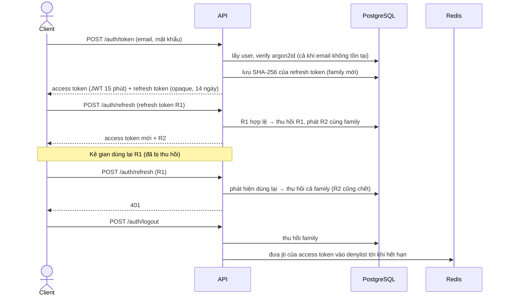

# Bảo mật

## Xác thực



- **Access token**: JWT HS256, chứa `sub`, `role`, `jti`, `iss`, `exp`. Khi giải mã luôn chỉ định thuật
  toán (`algorithms=["HS256"]`), nên token `alg: none` hoặc đổi thuật toán đều bị từ chối (có test).
- **Refresh token**: chuỗi ngẫu nhiên 256 bit, database chỉ lưu SHA-256 của nó. Lộ database không lộ
  được token còn dùng được.
- **Xoay vòng + phát hiện dùng lại**: mỗi lần refresh, token cũ bị thu hồi. Nếu một token đã thu hồi
  quay lại, nghĩa là đã có người có bản sao, nên toàn bộ token của phiên đăng nhập đó bị thu hồi.
- **Mật khẩu**: argon2id (tham số mặc định của argon2-cffi theo RFC 9106), chạy ngoài event loop.
- **Không lộ email nào đã đăng ký qua thời gian phản hồi**: email không tồn tại vẫn được verify với một
  hash giả, nên thời gian phản hồi như nhau; thông báo lỗi cũng giống hệt nhau.
  (Đánh đổi có chủ ý: `POST /auth/register` vẫn báo email đã tồn tại, để trải nghiệm đăng ký rõ ràng.)

## Phân quyền

- **RBAC** bằng dependency `require_roles(...)`: `customer`, `organizer`, `admin`.
- **Kiểm tra quyền trên từng đối tượng** ở tầng domain: đơn hàng, lượt giữ ghế, sự kiện nháp của người
  khác đều trả **404** thay vì 403, nên không dò được id nào tồn tại (IDOR). Id là UUID, không đoán được.
- Role nằm trong access token nên đổi role có hiệu lực ở lần refresh kế tiếp (tối đa 15 phút). Đây là
  cái giá của việc không đọc database ở mỗi request.

## OWASP Top 10 (2021)

| Rủi ro | Biện pháp trong dự án |
|---|---|
| A01 Broken Access Control | RBAC, kiểm tra quyền trên từng đối tượng, 404 cho tài nguyên của người khác, UUID |
| A02 Cryptographic Failures | argon2id; refresh token chỉ lưu hash; HMAC-SHA256 cho webhook; so sánh constant-time (`hmac.compare_digest`, `subtle.ConstantTimeCompare`); TLS ở Ingress |
| A03 Injection | Truy vấn có tham số (SQLAlchemy); escape ký tự `%`/`_` trong tìm kiếm `ILIKE`; escape HTML trong email; chặn xuống dòng trong header email (thư viện `email` của Python) |
| A04 Insecure Design | Giới hạn vé mỗi người, idempotency, state machine; các bất biến quan trọng đặt bằng constraint của database |
| A05 Security Misconfiguration | Chặn secret yếu khi `ENV=production`; header bảo mật (`nosniff`, `DENY`, `no-referrer`, `no-store`); metrics không đi qua load balancer công khai; giới hạn body 1 MB ở nginx; CORS mặc định tắt |
| A06 Vulnerable Components | Phụ thuộc khoá phiên bản bằng `uv.lock`; image nền tối thiểu (slim, `scratch` cho Go). Nên thêm Trivy/Dependabot vào CI |
| A07 Identification & Authentication Failures | Rate limit đăng nhập theo email (5/phút) và theo IP (30/phút); token ngắn hạn; xoay vòng refresh token |
| A08 Software & Data Integrity Failures | Webhook phải có chữ ký HMAC hợp lệ; chống replay bằng timestamp (5 phút); `alembic check` trong CI |
| A09 Logging & Monitoring Failures | Log JSON có `request_id`/`user_id`; cảnh báo khi phát hiện dùng lại refresh token, khi số tiền webhook không khớp; Sentry; `request_id` từ client được kiểm tra để chặn chèn log giả |
| A10 SSRF | Server chỉ gọi tới `PAYMENT_BASE_URL` cố định trong cấu hình, không bao giờ gọi URL do người dùng gửi |

## Webhook

```
X-PayMock-Signature: t=1700000000,v1=<hex(HMAC_SHA256(secret, "1700000000." + raw_body))>
```

- Ký trên **raw body**, nên API kiểm tra chữ ký trước khi parse JSON.
- Timestamp nằm trong phần được ký; lệch quá 5 phút thì từ chối (chống phát lại).
- Python ([signatures.py](../services/api/app/core/signatures.py)) và Go
  ([webhook.go](../services/payment-gateway/webhook.go)) cùng kiểm một vector chữ ký trong test, để hai
  bên không lệch nhau.
- Xử lý idempotent theo id của sự kiện webhook, vì cổng có thể gửi lại.

## Secret và cấu hình

- Không có secret thật trong Git. `.env.example` và overlay `local` chỉ chứa giá trị cho máy cá nhân.
- Production: secret nằm trong Kubernetes Secret `sanve-secrets`, được tạo ngoài Git (External Secrets
  Operator, Sealed Secrets hoặc `kubectl create secret`).
- `Settings` từ chối khởi động khi `ENV=production` mà `JWT_SECRET`, `PAYMENT_API_KEY` hoặc
  `PAYMENT_WEBHOOK_SECRET` ngắn hơn 32 ký tự hoặc trông giống giá trị mặc định.

## Container và Kubernetes

- Image Python chạy bằng user không phải root (uid 10001); image Go build từ `scratch`, chỉ có binary.
- Namespace bật Pod Security `restricted`: `runAsNonRoot`, `allowPrivilegeEscalation: false`, bỏ mọi
  capability, `seccompProfile: RuntimeDefault`. Thêm vào đó: root filesystem chỉ đọc, không mount
  service account token.
- Readiness/liveness tách bạch; mọi container của ứng dụng đều có giới hạn bộ nhớ.

## Chưa làm

- Xác thực hai lớp, khoá tài khoản sau nhiều lần đăng nhập sai (hiện chỉ có rate limit).
- Chuyển JWT sang RS256/EdDSA kèm JWKS nếu có nhiều service cần tự kiểm tra token.
- NetworkPolicy giới hạn pod nào được nói chuyện với pod nào; quét image trong CI.
